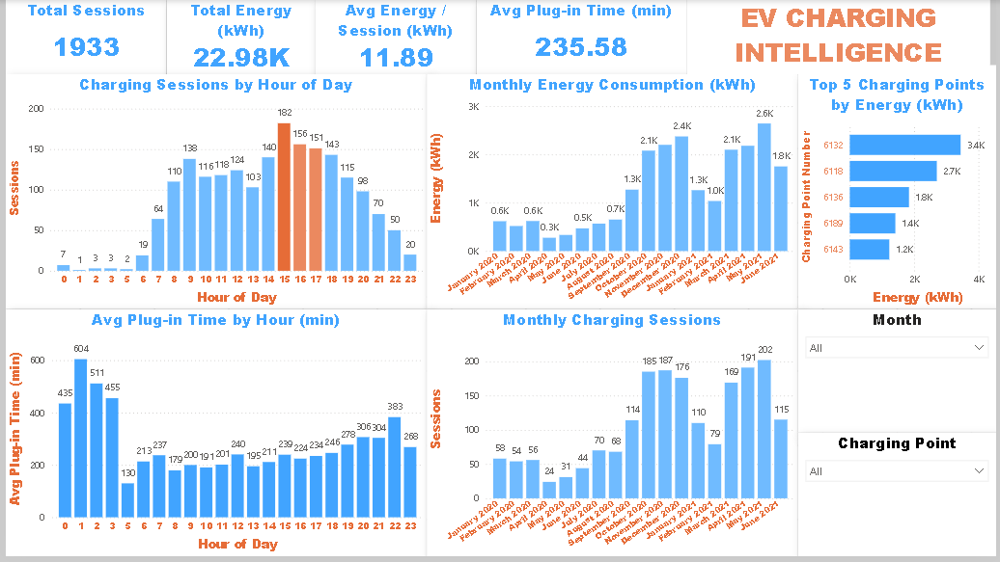

# EV Charging Intelligence Dashboard

## Overview
An interactive Power BI dashboard analysing 1,933 EV charging sessions (Jan 2020 to Jun 2021) to understand when, where and how much EVs charge.

## Objectives
- Find peak charging hours
- Track monthly growth in sessions and energy consumption
- Identify the top charging points by energy delivered
- Understand how long vehicles stay plugged in

## Key Insights
- Peak demand is 3-5 PM, with 3 PM alone seeing 182 sessions
- Monthly sessions grew ~3.5x, from 58 (Jan 2020) to 202 (May 2021)
- Station 6132 delivers the most energy (3.4K kWh), followed by 6118
- Average plug-in time is ~3.9 hours, much longer than the energy delivered needs, which suggests many vehicles stay connected after charging (interpretation, not confirmed by the data)

## Data Source
Dataset: Electric Vehicle Charging Transactions
Publisher: London Borough of Barnet, via data.gov.uk
Link: https://www.data.gov.uk/dataset/16c7326b-57fe-4803-88f8-9286c387f68a/electric-vehicle-charging-transactions

## Workflow
Raw data -> Python (Google Colab) cleaning -> SQL -> Power BI (Power Query + dashboard)

## Data Cleaning
- Python (Google Colab): basic cleaning, missing values and duration columns
- Power Query: sessions longer than 720 min (12 hrs) were excluded
  - 2,193 sessions before filter, 260 removed (~12%), 1,933 after filter
  - Reason: average plug-in time was 314 min, and the maximum was 1,698 min (~28 hrs), which looked like idle plug-in or logging anomalies

## Tools Used
- Python (Pandas), Google Colab
- SQL
- Power BI (DAX, Power Query, data modelling, slicers)

## How to Reproduce
1. Run the Colab notebook on the raw data to get ev_charging_cleaned.csv (2,193 rows).
2. Load it in Power BI. In Power Query, filter Charging_Duration_Min <= 720. This removes 260 sessions and leaves 1,933 rows.
3. Or load ev_charging_final.csv directly (already filtered, 1,933 rows).

## Files
- ev-charging-intelligence-powerbi.png: final dashboard screenshot
- EVCharge_Intelligence_Analytics.pbix: Power BI dashboard
- EV_Charging_Data_Cleaning.ipynb: Colab notebook (data cleaning)
- ev_charging_raw.csv: original raw data
- ev_charging_cleaned.csv: after Python cleaning (2,193 rows)
- ev_charging_final.csv: after outlier filter (1,933 rows)

## Limitations
- The 12-hour cutoff is a judgement call, not a rule from the data
- Plug-in time is not the same as actual charging time
- Dataset covers one UK borough, so results may not generalise

## Author
**Abhay Marwade**

Aspiring Data Analyst

GitHub: https://github.com/ABHAYMARWADE2004
LinkedIn: https://www.linkedin.com/in/abhay-marwade-681108295
